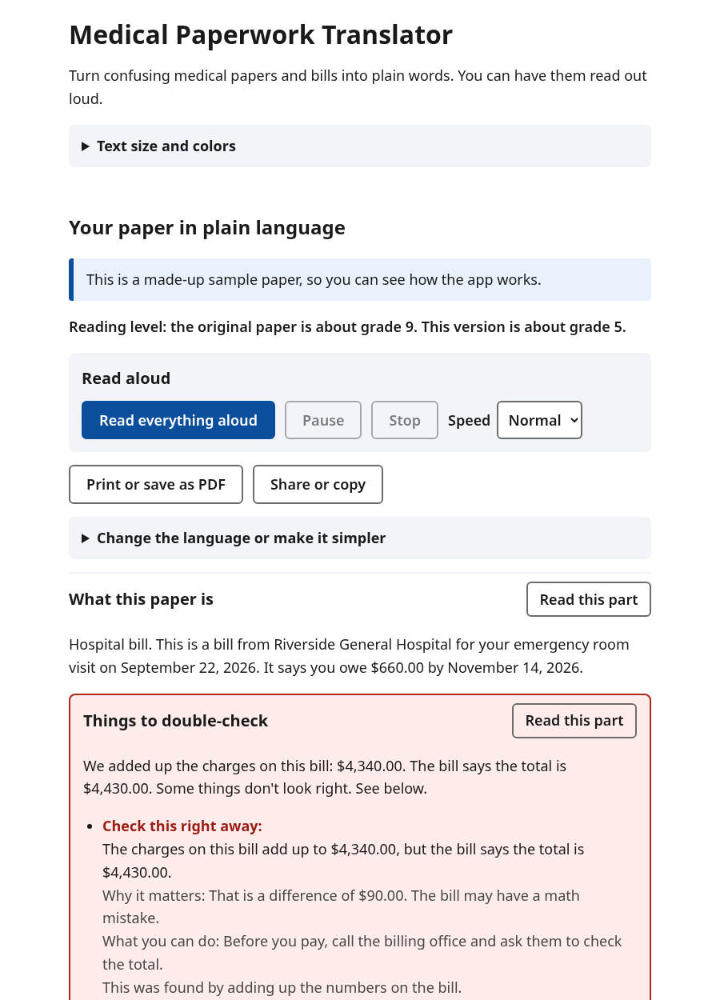

# Medical Paperwork Translator

**Turns confusing medical papers and bills into plain language, reads them out loud, and points out mistakes worth checking.**

Discharge instructions, test results, insurance letters, and hospital bills are hard to read for anyone. They're
harder still for people with intellectual or learning disabilities, brain injuries, low vision, or dyslexia, and for
people reading in a second language. Take a photo of the paper, upload a PDF, or paste the words. The app explains
the paper in short, everyday sentences, can read it aloud, and points out anything that looks wrong, like a bill
that doesn't add up.

Built for a hackathon on accessibility tools for navigating the medical care system.



## Try it on the web

**[Open the web version](https://maestorm1405.github.io/paper-work-translator/)**: nothing to install. It runs entirely in
your browser, without AI and without an API key. Your papers are read on your device and never uploaded. For the full
AI translation, other languages, and new questions, download the app below.

## Download the app

**[Download from the Releases page](https://github.com/Maestorm1405/paper-work-translator/releases/latest)**: a real app
with its own window for **Mac (Apple silicon)** and **Windows**. No browser, no Terminal, no Python needed.

- **Mac:** unzip, drag the app to Applications, and open it. The first time, macOS says it can't check the app because
  it isn't signed by Apple yet: click **Done**, then go to **System Settings → Privacy & Security → Open Anyway**.
- **Windows:** extract the zip, open the folder, and run **Medical Paperwork Translator.exe**. If you see "Windows
  protected your PC", click **More info → Run anyway**.

The app adds dates straight to your calendar app (Apple Calendar or Outlook), scans papers with your camera, and keeps
your API key on your computer only. Set the key under **Translation service (API key)** at the top of the app.

## Features

| | |
|---|---|
| **Plain-language translation** | Photo, PDF, or pasted text in; the paper explained at about a 5th grade reading level out. Medicine names, doses, dates, phone numbers, and money amounts are kept exactly as written. |
| **Mistake and concern check** | The app adds up bills itself and flags totals that don't match and charges listed twice. Claude flags other concerns, like two different doses for the same medicine, a date of birth that doesn't match, or a deadline that's easy to miss. Each one says why it matters and who to call. |
| **Read aloud** | Read everything, or one section at a time, with pause, stop, and speed. Each line is highlighted as it's read. |
| **Two reading levels** | *Simple* (about grade 5) or *Very simple* (easy read: short sentences, one idea each). A reading-level score shows the change, for example "the original paper is about grade 9. This version is about grade 5." |
| **11 languages** | English, Spanish, Chinese, Vietnamese, Tagalog, Arabic (right-to-left), French, Korean, Russian, Haitian Creole, and Portuguese. |
| **Ask a question** | Type or speak a question ("Should I take this for 5 days or 7?"). Answers come only from the paper, and the app points you to your doctor, pharmacist, or billing office for anything else. |
| **Add to calendar** | Appointments and deadlines go straight to a calendar file (iPhone, Android, Outlook) or Google Calendar, with a reminder the day before. |
| **Print or share** | A clean one-page summary with lines for notes, to bring to an appointment or send to a caregiver. |
| **Display settings** | Large and extra-large text, light, dark, and high-contrast colors, and extra spacing between lines, words, and letters. Saved in the browser. |
| **Camera scanner** | Scan one page or many with the camera. Each picture is checked, and the app tells you (out loud if you like) when it's too dark or blurry. |
| **Works with no API key** | Without a key, your own papers are read on your computer, offline: photos with a built-in text reader ([Tesseract](https://github.com/naptha/tesseract.js)), PDFs from their text. It explains abbreviations and medical words, finds medicines, dates, warning signs, and phone numbers, and runs the same bill math check. With a key, Claude gives a full plain-language translation. |
| **Works offline for demos** | Three made-up sample papers work with no API key and no internet. |

## Try it in 2 minutes

You need Python 3.10 or newer (check with `python3 --version`; get it from [python.org](https://www.python.org/downloads/)).

```bash
git clone https://github.com/Maestorm1405/paper-work-translator.git
cd paper-work-translator
python3 -m venv .venv              # Windows: py -m venv .venv
source .venv/bin/activate          # Windows: .venv\Scripts\activate
pip install -r requirements.txt
python -m paperwork_translator.desktop     # the app in its own window
# or: python -m paperwork_translator      # in your browser at http://127.0.0.1:8000
```

In the browser version, open <http://127.0.0.1:8000> and press **Try: A hospital bill**. You'll see:

1. A plain-language explanation of the bill.
2. **Things to double-check**: the charges add up to $4,340.00, but the bill says $4,430.00. A blood test is
   listed twice. Using the numbers on the bill, the person owes $570.00, not $660.00.
3. **Read everything aloud** reads the whole thing, highlighting as it goes.
4. Under **Ask a question**, press "How much do I really owe?"
5. **Add to calendar** on the payment due date.

The other two samples are discharge instructions, where the antibiotic says 5 days in one place and 7 in another,
and an insurance letter denying a power wheelchair, where the date of birth doesn't match.

### Translating your own papers

Your own papers, other languages, and new questions use Claude, so you need an
[Anthropic API key](https://console.anthropic.com):

```bash
cp .env.example .env               # then paste your key into .env
python -m paperwork_translator
```

| Setting in `.env` | What it does |
|---|---|
| `ANTHROPIC_API_KEY` | Required for anything beyond the samples. |
| `TRANSLATOR_MODEL` | Defaults to `claude-opus-5-5`. |
| `TRANSLATOR_EFFORT` | `low`, `medium` (default), or `high`. `low` answers faster, which helps in a live demo. |

To use it from a phone on the same Wi-Fi (handy for taking photos of papers), run
`python -m paperwork_translator --host 0.0.0.0` and open `http://<your-computer's-IP>:8000` on the phone. If the
event Wi-Fi blocks this, a phone hotspot usually works.

## How it works

```
Browser (HTML/CSS/JS, no build step)          FastAPI server                       Claude API
  photo / PDF / text ── shrinks big photos ──▶ /api/translate ── image or PDF ──▶ claude-opus-5-5
                                                checks file type and size          structured JSON output
  plain-language sections ◀── adds bill math, ◀── validated with Pydantic ◀─────────┘
  read aloud (Web Speech API)    reading-level score
  questions ─────────────────────────────────▶ /api/ask ── paper + question ──▶ short plain-text answer
```

- **One Claude call per paper.** [`translator.py`](paperwork_translator/translator.py) sends the image, PDF, or text
  with a system prompt. The prompt says to write at the chosen reading level, keep every dose and number exactly as
  written, never add advice, never skip a warning, and say which parts couldn't be read. Structured outputs make
  Claude return a fixed JSON schema: summary, warning signs, concerns, to-dos with dates, medicines, terms, bill
  lines, and the original words. The request streams, so long papers don't time out, and uses server-side fallbacks
  in case a request is declined.
- **The app checks the math itself.** AI can get arithmetic wrong, so Claude only *copies* the bill lines.
  [`checks.py`](paperwork_translator/checks.py) adds them up exactly in decimal, compares them with the printed
  total and amount due, and looks for repeated charges. It also scores reading level (Flesch-Kincaid grade).
- **Nothing is stored.** Questions send back the paper's words that the browser already has, so the server never
  saves a paper. Display settings live in the browser's local storage.
- **Read aloud and voice input** use the browser's built-in speech features, with no extra service or cost.

```
paperwork_translator/
  app.py            web server and API endpoints
  translator.py     Claude prompts, output schema, error handling
  checks.py         bill math, repeated charges, reading level
  samples/          the three made-up papers, with ready-made results
  static/           the page: index.html, styles.css, app.js, speech.js, calendar.js, settings.js
tests/              pytest (server) and node:test (calendar files)
```

## Accessibility

The app is built for the people it serves:

- Works with screen readers and keyboard only. It has real headings, labels, and landmarks, a skip link, and visible
  focus. Updates are announced, and focus moves to the results and to each new answer.
- Every translated line is tagged with its language, and Arabic displays right to left, so screen readers and the
  read-aloud voice pronounce it correctly.
- Buttons are at least 44 pixels tall, and visible button names match their spoken names, so voice-control users
  can say "click Read this part".
- The page fits a 320-pixel-wide screen even at extra-large text with extra spacing (WCAG reflow and text spacing).
- Dark mode, high contrast, and reduced motion are supported, and no meaning is shown by color alone.
- Automated [axe](https://github.com/dequelabs/axe-core) checks report no violations in light, dark, and
  high-contrast mode, at normal and extra-large text, with extra spacing, with the calendar panel open, and with
  right-to-left Arabic results. Automated checks don't catch
  everything, so please also try it with VoiceOver, NVDA, or TalkBack.

## Privacy and safety

- Papers are sent to Anthropic's API to be read. This app doesn't save them or log their contents. The sample
  papers never leave your computer.
- "Speak your question" uses the browser's speech service, which may send audio to an online service (Chrome
  uses Google's).
- This is a helper, not medical, legal, or financial advice. The page tells people to trust the original paper and
  check with their doctor, pharmacist, or billing office. The mistake check catches *some* problems; it can't
  know whether you actually received a service.
- All names, numbers, and organizations in the sample papers are made up. Phone numbers use the reserved 555-01xx
  range.

## Limits

- Photos up to 5 MB (bigger ones are shrunk automatically), PDFs up to 20 MB, and pasted text up to 100,000
  characters.
- The app's buttons and headings are in English. The translation itself can be in any of the 11 languages.
- Bill math messages are in English, and dollar amounts are formatted for the U.S.
- Sample papers open instantly. Your own papers take longer, because Claude reads the whole page.
  `TRANSLATOR_EFFORT=low` speeds this up.
- Some devices don't have voices for every language. The app warns you when that happens.

## Running the tests

```bash
pip install -r requirements-dev.txt
python -m pytest                        # 48 tests: API, error handling, samples, bill math, reading level
node --test tests/calendar.test.mjs     # 5 tests: calendar files and Google Calendar links
```

The tests use a fake Claude client, so they need no API key or internet.

## Built with

[Claude](https://www.anthropic.com/claude) (Opus 5.5) through the Anthropic Python SDK, plus
[FastAPI](https://fastapi.tiangolo.com/), plain HTML, CSS, and JavaScript, and the Web Speech API.
